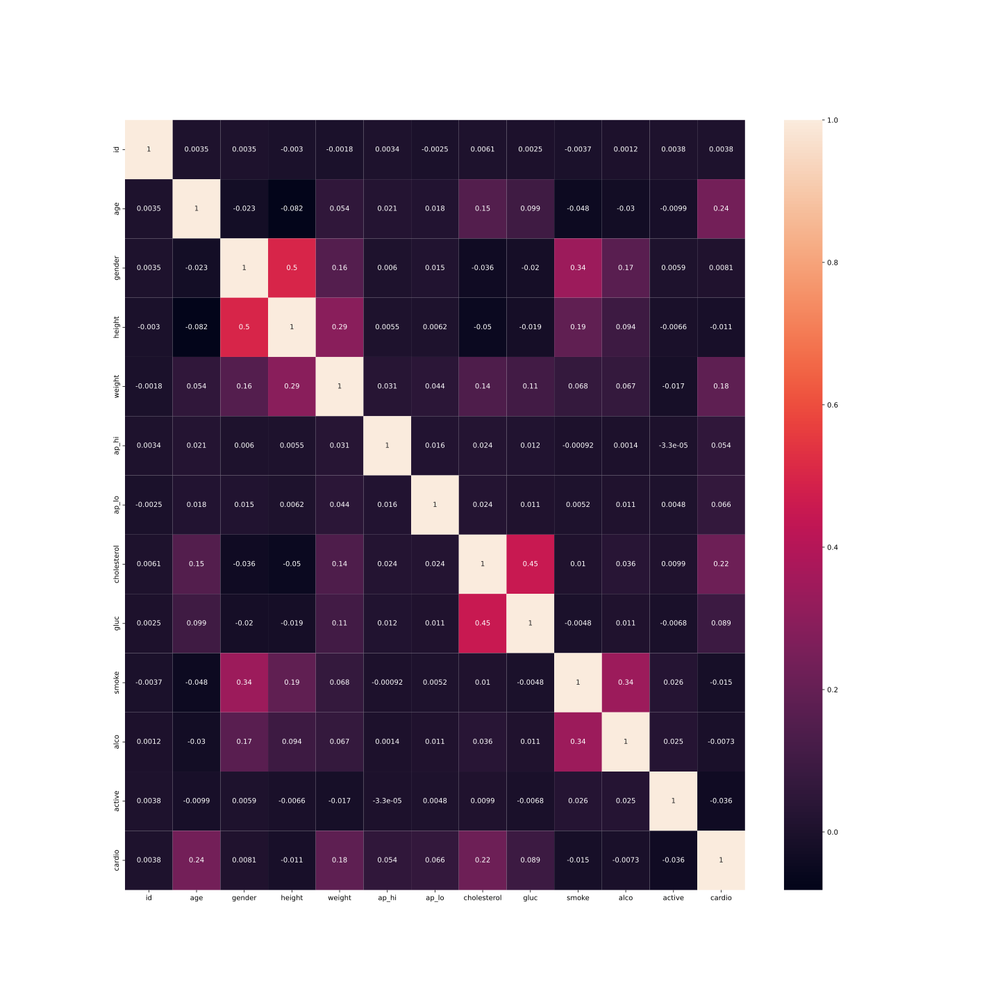
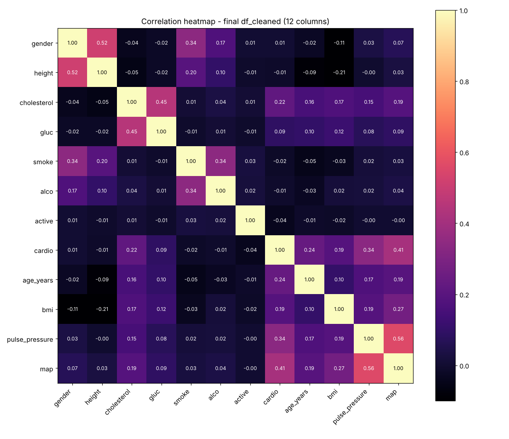
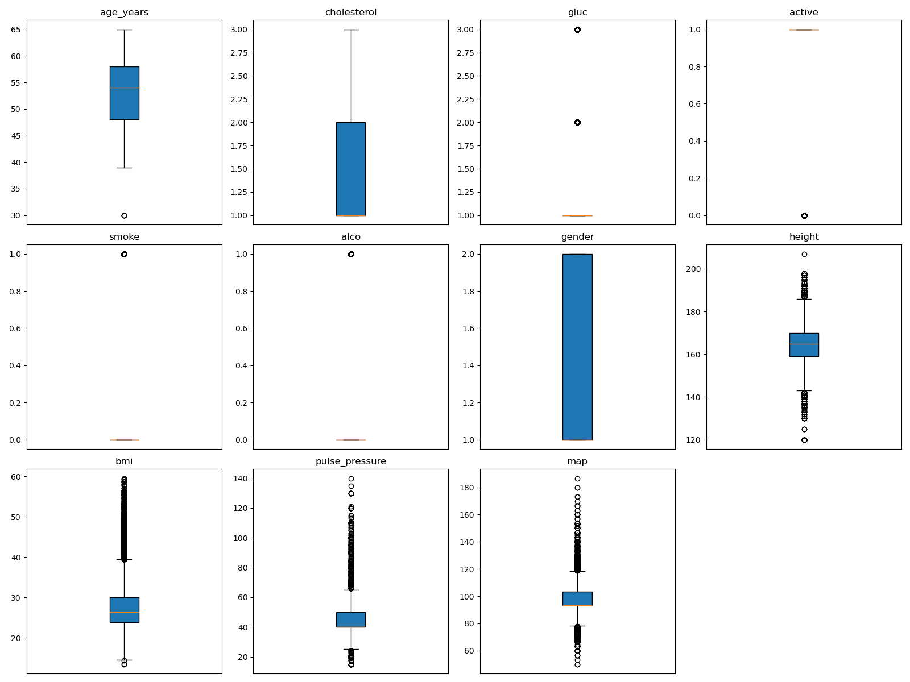

# Cardiovascular Disease Prediction – Data Preparation & Feature Engineering Summary

The notebook went from 70,000 raw rows and 13 columns, with impossible values, to 68,511 clean rows and 12 columns including four engineered features. Data: `Raw Dataset.csv` (Kaggle cardiovascular disease dataset), target `cardio` (1 = disease). No train/test split has been done yet.

## Before vs now

Cleaning removed 1,489 rows (2.1%) and left 12 columns with no impossible values.

| Item | Before | Now |
|---|---|---|
| Rows | 70,000 | 68,511 |
| Columns | 13 | 12 |
| File loading | 1 merged column (wrong separator) | 13 proper columns (`sep=";"`) |
| height (cm) | 55 to 250 | 120 to 207 |
| weight (kg) | 10 to 200 | replaced by `bmi` |
| ap_hi / ap_lo | -150 to 16,020 / -70 to 11,000 | replaced by `map` and `pulse_pressure` |
| bmi | not present | 13.5 to 59.5 |
| pulse_pressure | not present | 15 to 140 |
| age | days | `age_years` (years) |
| id | present | dropped |

## Changes in order

These follow the notebook cells from top to bottom.

| Step | Change | Before | Now |
|---|---|---|---|
| 1 | Load with `sep=";"` | everything in one column, all object types | 13 numeric columns |
| 2 | Checks | unknown quality | no duplicates, no missing values, gender is {1, 2}, smoke is {0, 1} |
| 3 | Drop `id` | 13 columns | 12 columns |
| 4 | Add `age_years` and `bmi` | age in days, no BMI | age in years, bmi = weight / height² |
| 5 | Blood-pressure filter, then add `pulse_pressure` and `map` | ap_hi up to 16,020, ap_lo negative | 68,671 rows, plausible pressures |
| 6 | Filter height, weight, BMI and pulse pressure | height 55 to 250, bmi up to about 299 | height 120 to 207, bmi 13.5 to 59.5 |
| 7 | Drop `ap_hi`, `ap_lo`, `weight` and save as `df_cleaned` | 16 columns | 13 columns |
| 8 | Drop `age` (days) | 13 columns | 12 columns |
| 9 | Save `Cleaned Dataset.csv` | in memory only | saved to disk |

Rows remaining after each filter in steps 5 and 6:

| Filter | Rows left | Removed |
|---|---|---|
| Start | 70,000 | 0 |
| `ap_hi` > `ap_lo`, `ap_hi` 70 to 250, `ap_lo` 40 to 200 | 68,671 | 1,329 |
| height 120 to 220 cm | 68,621 | 50 |
| weight 30 to 200 kg | 68,615 | 6 |
| bmi 13 to 60 | 68,588 | 27 |
| `pulse_pressure` at least 15 | 68,511 | 77 |

## Correlation heatmaps

Blood pressure looked weak in the raw data (0.05 to 0.07) only because of impossible values; after cleaning and combining, `map` is the strongest feature at 0.41.

**Before: raw data, 13 columns.** `ap_hi` and `ap_lo` barely correlate with `cardio`, and `id` is noise (0.004). The strongest feature pairs are `gender` and `height` (0.50), and `cholesterol` and `gluc` (0.45).

**Now: final `df_cleaned`, 12 columns.** `map` (0.41) and `pulse_pressure` (0.34) lead. The largest pair is `pulse_pressure` and `map` (0.56), and no pair is above 0.6, so the redundancy is gone. This image is redrawn from the CSV with the notebook's steps, because the notebook's own final heatmap was saved as an SVG that could not be read.

Correlation of each feature with `cardio`:

| Feature | Raw data | Final data |
|---|---|---|
| `map` | new | 0.409 |
| `pulse_pressure` | new | 0.338 |
| `age` / `age_years` | 0.24 | 0.239 |
| `cholesterol` | 0.22 | 0.222 |
| `bmi` (replaces `weight`) | 0.18 | 0.191 |
| `gluc` | 0.089 | 0.090 |
| `active` | -0.036 | -0.038 |
| `smoke` | -0.015 | -0.016 |
| `height` | -0.011 | -0.012 |
| `gender` | 0.008 | 0.007 |
| `alco` | -0.007 | -0.008 |
| `ap_hi` | 0.054 | dropped |
| `ap_lo` | 0.066 | dropped |
| `id` | 0.004 | dropped |

## Outlier boxplots

Filtering removed the impossible heights and BMIs, and the dots that remain are realistic extremes.

**Before: only blood pressure cleaned.** `height` ran from 55 to 250 cm and `bmi` up to about 299, which squashed their boxes into thin lines.

**Now.** `height` is 120 to 207 cm, `bmi` is 13.5 to 59.5 and `pulse_pressure` is 15 to 140. The boxes are readable.

The remaining dots on `pulse_pressure` and `map` are kept: earlier checks showed about 73% heart disease among `pulse_pressure` outliers, against 48% for the rest. The dots on `gluc`, `active`, `smoke` and `alco` are just the minority class, not outliers.

## Features created and dropped

Four features were created and five columns dropped; accuracy stayed at about 73% in a 5-fold check, and every VIF fell below 1.6.

| Feature | Action | Why |
|---|---|---|
| `age_years` | created | `age` in days divided by 365.25; correlation 0.239 |
| `bmi` | created | combines height and weight; correlation 0.191 |
| `pulse_pressure` | created | `ap_hi` minus `ap_lo`; correlation 0.338 |
| `map` | created | (`ap_hi` + 2 × `ap_lo`) / 3; strongest at 0.409 |
| `id` | dropped | row label with no signal |
| `age` | dropped | duplicate of `age_years` (correlation 0.999) |
| `ap_hi`, `ap_lo` | dropped | `map` and `pulse_pressure` rebuild both exactly; keeping all four made the VIF infinite |
| `weight` | dropped | correlated 0.86 with `bmi` |
| `gender`, `smoke`, `alco`, `height`, `active` | kept for now | weak (absolute correlation 0.04 or less); check feature importance before removing |

## Where it stands and next steps

`df_cleaned` has 68,511 rows and 12 columns (`gender`, `height`, `cholesterol`, `gluc`, `smoke`, `alco`, `active`, `age_years`, `bmi`, `pulse_pressure`, `map` and the target `cardio`). It is saved as `Cleaned Dataset.csv` and has not been split yet.

1. Split into train and test sets with `stratify=y`.
2. Train a baseline (random forest and logistic regression); about 73% accuracy is the expected level.
3. Check feature importance to decide on `gender`, `smoke`, `alco`, `height` and `active`.
4. Use `RobustScaler` for linear models, since some outlier dots remain.
